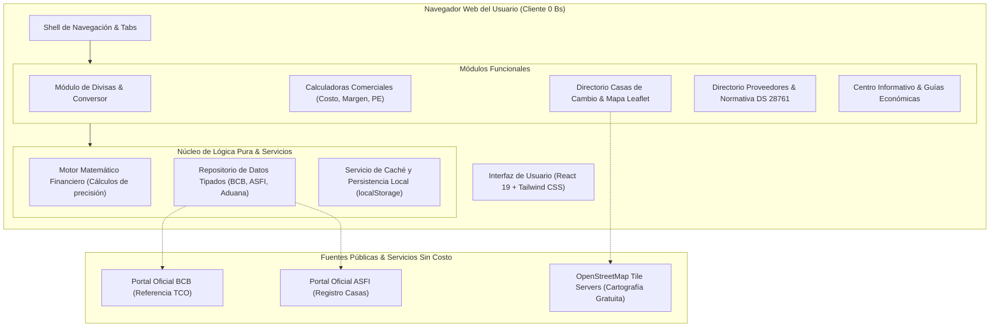

# ARQUITECTURA DEL SISTEMA — CAMBIO BOLIVIA

Este documento describe la arquitectura modular, el flujo de datos, los componentes y la infraestructura técnica de Cambio Bolivia.

---

## 1. Diagrama Arquitectónico

---

## 2. Organización de Capas del Código Fuente

El código se organiza bajo el principio de separación estricta de responsabilidades en `src/`:

- `src/types/`: Definiciones estrictas de TypeScript (`currency.ts`, `exchangeHouse.ts`, `calculator.ts`, `supplier.ts`, `guide.ts`).
- `src/utils/`: Lógica de negocio y funciones matemáticas puras independientes de la UI:
  - `financialMath.ts`: Funciones de redondeo, conversión de divisas, margen bruto, markup, cálculo de importación y punto de equilibrio.
  - `dateFormatting.ts`: Cálculo de antigüedad relativa (*hace 2 horas*, *ayer*, etc.) y banderas de obsolescencia.
- `src/data/`: Datos verificados iniciales con tipado estricto:
  - `officialRates.ts`: Tipos de cambio oficiales y comerciales con metadatos completos de auditoría.
  - `exchangeHouses.ts`: Directorio geolocalizado con datos públicos de ASFI en capitales de Bolivia.
  - `suppliers.ts`: Directorio curado de proveedores comerciales lícitos y advertencias normativas.
  - `educationalGuides.ts`: Contenidos divulgativos y glosario financiero boliviano.
- `src/components/`: Componentes modulares y reutilizables:
  - `layout/`: Navbar, Footer, Header, DisclaimerBanner.
  - `currency/`: CurrencyConverter, RateCard, RateComparisonTable.
  - `calculators/`: CommercialCostCalculator, ProfitMarginCalculator, BreakEvenCalculator, SupplierCostComparator.
  - `exchangeHouses/`: ExchangeHouseList, ExchangeHouseMap, FilterBar.
  - `suppliers/`: SupplierDirectory, LegalNoticeCard.
  - `guides/`: GuideReader, FinancialGlossary.
  - `common/`: Badges, InputField, Modal, StatCard.
- `src/tests/`: Pruebas unitarias de lógica matemática y conversión con Vitest.

---

## 3. Flujo de Datos para Cotizaciones

1. **Consulta del estado actual:** La UI lee desde `DataRepo`.
2. **Cálculo de antigüedad:** Se compara `effectiveDate` contra la fecha del sistema (`new Date()`).
   - Si la antigüedad es menor a 24 horas hábiles: Estado **"Vigente y Verificado"** (Verde).
   - Si la antigüedad es mayor a 24 horas y menor a 72 horas: Estado **"Referencia previa"** (Amarillo).
   - Si la antigüedad es mayor a 72 horas: Estado **"Dato no actualizado recientemente"** (Rojo / Advertencia).
3. **Cálculo de conversión:** La cantidad de origen se normaliza contra el Boliviano (BOB) como pivote o mediante el par directo documentado.
4. **Presentación:** Los resultados se formatean con separador de miles y decimales según la convención boliviana (`Bs 1.234,56`).
